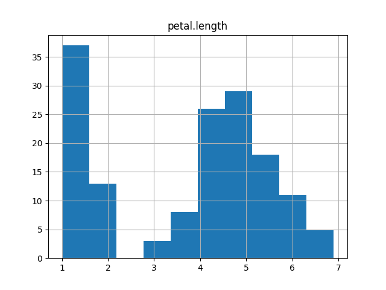

# Iris Flower Dataset — Exploratory Data Analysis

**Python · pandas · NumPy · Matplotlib · Seaborn**

An exploratory analysis of the classic Iris dataset, examining how sepal and petal measurements vary across three flower species.



## The question

Can basic summary statistics and visualisations help identify meaningful differences between Iris setosa, versicolor and virginica?

## What I built

- Loaded and explored the dataset using pandas.
- Calculated descriptive statistics for the four flower measurements.
- Produced histograms and scatter plots to compare feature distributions.
- Used visual analysis to explore relationships between features and species.
- Documented the approach and findings in a notebook and standalone Python script.

## Files

| File | Purpose |
| --- | --- |
| [Project.ipynb](./Project.ipynb) | Step-by-step notebook with analysis and commentary |
| [analysis.py](./analysis.py) | Python analysis script |
| [iris.csv](./iris.csv) | Dataset used in the project |
| [summary.txt](./summary.txt) | Generated descriptive summary |
| [petallength.png](./petallength.png), [petalwidth.png](./petalwidth.png) | Petal measurement charts |
| [sepallength.png](./sepallength.png), [sepalwidth.png](./sepalwidth.png) | Sepal measurement charts |

## Run it locally

```bash
python -m pip install pandas numpy matplotlib seaborn jupyter
python analysis.py
```

Run from the repository directory so relative data paths resolve. Alternatively, open `Project.ipynb` in Jupyter.

## What it demonstrates

Data loading and inspection, exploratory analysis, visual communication and working with a small multivariate dataset. **This is exploratory coursework, not a deployed predictive model.**

---

Part of my Higher Diploma in Computing (Data Analytics). [View my project portfolio](https://github.com/benjanning/programming2022).
