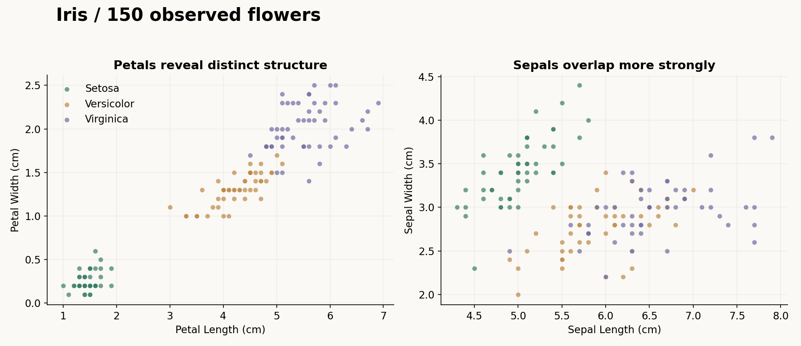
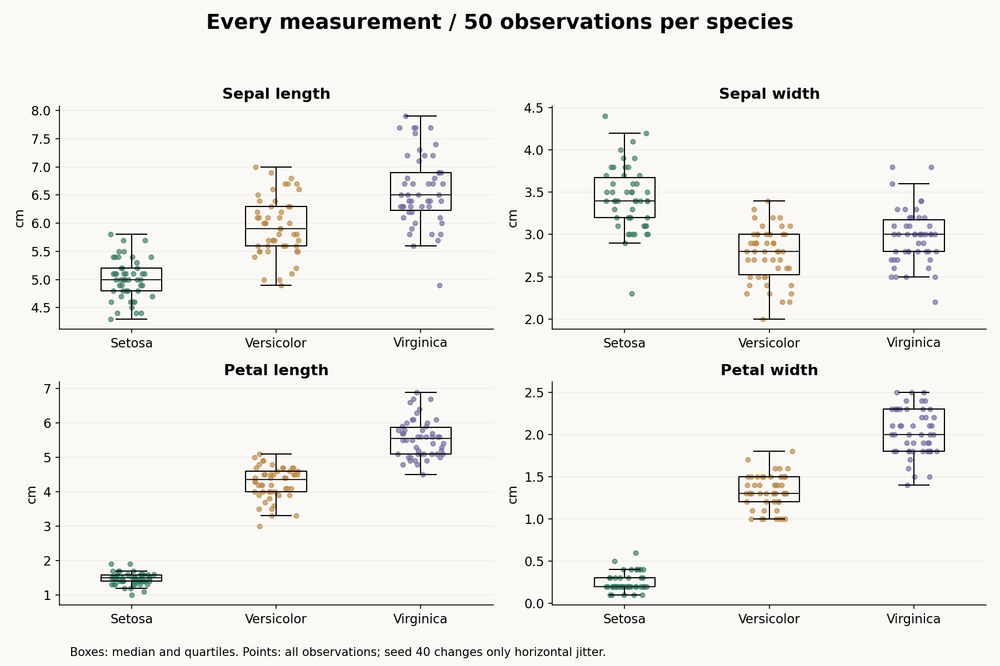
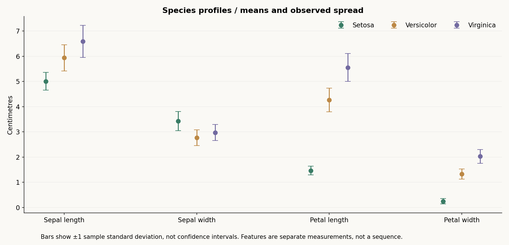

# Iris / three species, four measurements

A clear, reproducible exploration of 150 supplied flower observations, with fifty examples of each species.



**Python · pandas · NumPy · Matplotlib · Descriptive analysis**

[Explore the live observation lab](https://benjanning.github.io/pands-project/) · [Visual case study](https://benjanning.github.io/projects/projects/iris-analysis/) · [Portfolio](https://benjanning.github.io/projects/)

## One feature, all the observations

Choose **Distribution: one feature by species** to inspect a measurement's median, quartiles, IQR and full observed range. Every symbol remains an original row at its exact feature value. Small vertical offsets separate points and have no measurement meaning; the summary strips sit below each point row so both remain visible.

Quartiles use linear interpolation at `(n − 1) × p` (Type 7). Whiskers show observed minimum and maximum, rather than outlier fences or confidence intervals. The summaries agree with independent Python references. Species filters keep the same scale; exports still include all four original measurements. Return to the scatter view or its presets to compare two features.


[Distribution design and independent checks](DISTRIBUTIONS.md)

## Working observation lab

Filter the three observed species, choose any of four measurements on either axis, and compare petals with sepals using presets. The plot retains fixed ranges for each feature and uses shapes as well as colour. Summary cards calculate sample means and SD from selected source rows. Inspect the exact rows in an accessible table, download a filtered CSV or retrieve the unchanged original file. An empty selection offers a clear recovery state.

The browser calculations are checked against independent Python summaries for all sixteen feature pairings at desktop and mobile widths. Five Node checks cover sample SD edge cases and CSV quoting/order; five browser journeys also check filters, downloads and failed loading. [Design and verification](OBSERVATION-LAB.md).

Build the lab with `python build_explorer.py` after analysis. Install pinned browser tooling with `npm ci`, run `npm run test:rules`, then `npx playwright install chromium` and `npm run test:browser`. Serve the generated `docs/` folder for local exploration. Generated data and browser captures are rebuilt by the existing release workflow, which publishes Pages and a commit-identified portfolio package.

## What the measurements show

Setosa forms a distinct petal cluster in these observations. Versicolor and Virginica overlap; sepal measurements overlap more strongly. Colours are the supplied species labels, not model predictions.



Each point is an actual measurement in centimetres. Boxes show medians and quartiles. A fixed seed changes only horizontal point placement, preserving all values and repeated rows.



Bars show one sample standard deviation on either side of the mean. They describe observed spread and are not confidence intervals. Features are separate measurements, not a sequence.

## Reproduce and inspect

```bash
python -m pip install -r requirements.txt
python explore_iris.py
python -m unittest discover -p "test_*.py" -v
```

The entry point resolves paths independently of the working directory and saves three figures, [twelve species/feature summaries](results/species-summary.csv), [pooled correlations](results/pooled-correlations.csv) and [input provenance and versions](results/analysis.json). Six Python tests independently reconcile means and standard deviations, validate counts/hash and reproduce numeric files exactly. The added quartile check uses standard-library inclusive quantiles independently of NumPy; browser journeys reconcile actual point/box geometry with source values and Python references. Source CI regenerates figures and exports a commit-identified verified package for the portfolio's review process.

## Source and interpretation

The preserved [iris.csv](iris.csv) is an Iris teaching dataset variant. [UCI's Iris record](https://archive.ics.uci.edu/dataset/53/iris) documents the four measurements in centimetres, three species and historical corrections to observations 35 and 38. This project records those supplied rows and the file hash rather than silently replacing data. UCI provides the dataset under [CC BY 4.0](https://creativecommons.org/licenses/by/4.0/); see its record for original attribution to R. A. Fisher and the dataset history.

Identical measurement rows are retained: equal measurements alone do not establish duplicate sampling. Pooled correlations can reflect differences between species; they do not establish causation. This descriptive exploration does not measure general classifier performance. Original educational classifier examples, `analysis.py`, `Project.ipynb`, charts and [coursework documentation](COURSEWORK.md) remain available.

[Visual provenance](assets/PROVENANCE.md)
