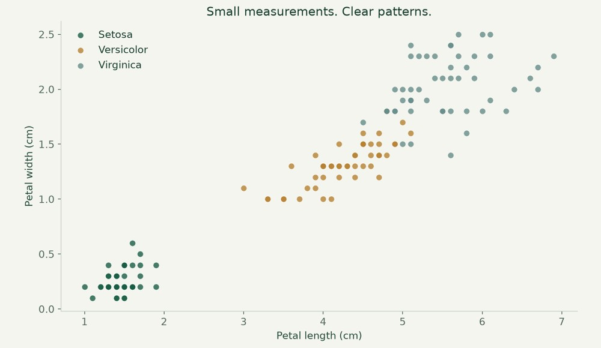

# Iris dataset exploration

Use summary statistics and visual exploration to reveal patterns in the Iris dataset.



**Python · pandas · NumPy · Seaborn**

[Visual case study](https://benjanning.github.io/projects/projects/iris-analysis/) · [Main portfolio](https://benjanning.github.io/projects/)

## What it does

Created a Python analysis script and notebook to summarize Iris measurements and explore relationships between features and species.

## Key features

- Included CSV, descriptive summaries and distribution plots.
- Feature relationships, pair plots and numeric correlations.
- Educational classifier examples with a seeded stratified split.

## Run the analysis

```bash
python -m pip install -r requirements.txt
python analysis.py
```
Run from the repository root. For the full notebook, open Project.ipynb in a Jupyter interface installed separately.

## Technical details and verification

The corrected notebook executed all 25 code cells in V1. The preview is a newly plotted presentation of the included measurements, with given species labels rather than predictions. The Iris teaching dataset is not evidence of general model performance. Original script, figures, data and source references remain available.

[Original documentation and academic references](COURSEWORK.md) · [Visual provenance](assets/PROVENANCE.md)
